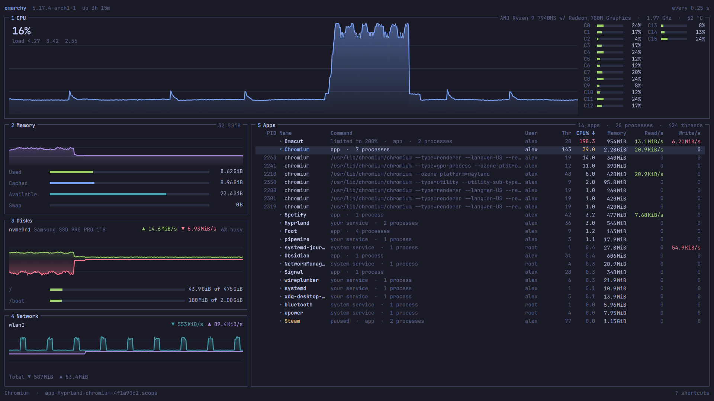
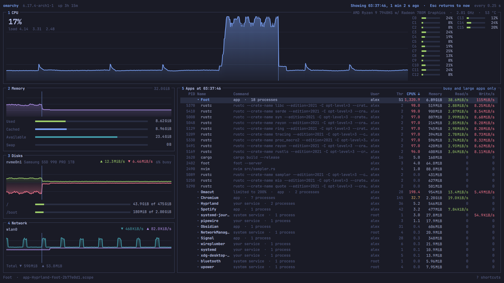
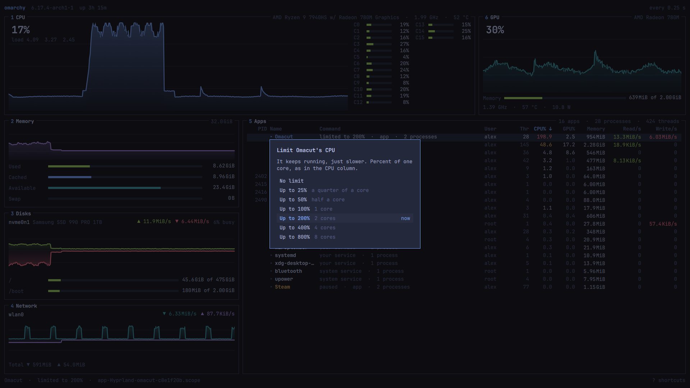
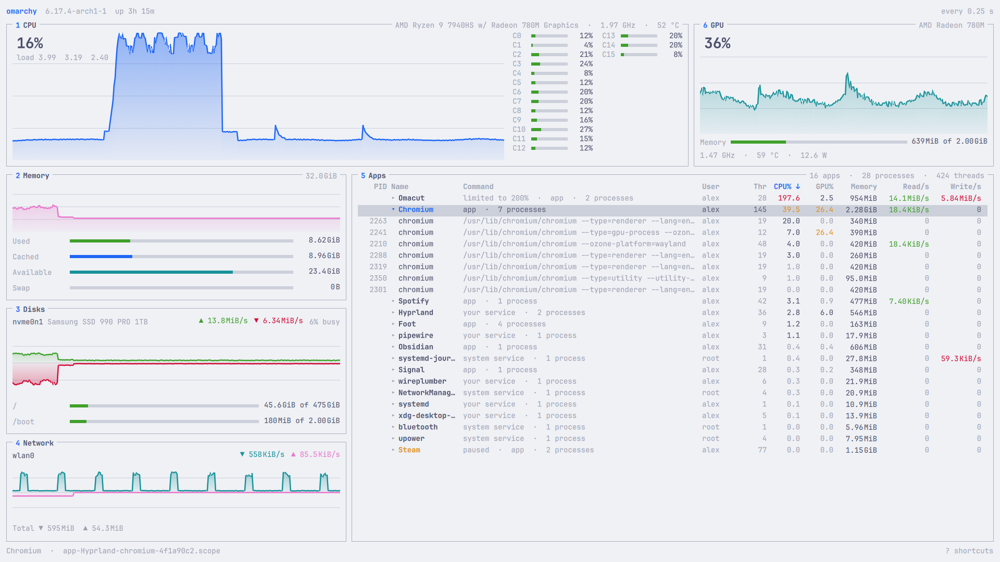

# Vitals

**A system monitor for [Omarchy](https://github.com/omacom/omarchy) that shows apps, not just processes.**
See what your machine is doing, find out what caused the spike you just
missed, and pause the app hogging your CPU instead of killing it.



Vitals is in the spirit of htop, bpytop, and btop, but built for the Omarchy
desktop: one keyboard-driven window, drawn on the GPU, following your theme,
font, and language as they change.

## What makes it different

**Apps, not a wall of processes.** Your browser's forty helpers are one row,
and the shells and builds in a terminal belong to that terminal. Vitals groups
processes by the systemd cgroups Omarchy launches every app in, and takes each
app's totals straight from the kernel's per-cgroup counters, which include
children that already exited and count shared memory once. Open an app with
`→` to see its processes, or press `a` for the classic flat list.

**Rewind.** A spike is usually over by the time you open a monitor. Vitals keeps
the last ten minutes: point at any moment on the CPU, memory, or disk graph to
see which apps were behind it, click (or press `[`) to see the whole list as it
was then, and `Esc` to come back.



**Pause or slow down an app instead of killing it.** `p` freezes every process
in an app until you press `p` again; `c` caps how much CPU it may use. A video
export can keep going on two cores while you work; a game launcher can sit
frozen until you want it back. Nothing is lost, and both undo themselves when
Vitals closes. It needs no root: it goes through systemd's user manager.



**Measure a command.** `vitals run` is `time` for things that fan out into many
processes, such as builds and test suites:

```
$ vitals run make -j8
...
vitals run: make -j8
  Time       9.85 s
  CPU        53.3 s of CPU time (user 52.0 s, system 1.36 s), 5.4 cores on average, 8.0 at the peak
  Memory     peak 2.22 GiB, 2.29 GiB with file cache
  Disk       read 0 B, wrote 0 B
  Waited     on CPU 0.00 s, on memory 0.00 s, on disk 0.00 s
  Processes  26 at most at once
  Exit       0
```

**Built for agents, too.** Every command works without a display and speaks
JSON, and `vitals skill install` teaches Claude Code and Codex to use it: ask
your agent why the machine is slow, and it can answer with the app, not a PID.

**At home on Omarchy.** Vitals follows the current theme live, the whole
palette, light or dark, along with Hyprland's window rounding, the desktop's
monospace font, and the language picked under Setup > Language.



## Install

Vitals isn't in Omarchy's package repository yet. To build and install it from
source on Omarchy (everything it needs is already there):

```sh
git clone https://github.com/carroarmato0/vitals.git
cd vitals
bin/install    # builds, then installs the package with pacman (asks for sudo)
```

Then open it from the app launcher (`Super + Space`, Vitals), or run
`vitals open`.

On another Arch-based system you need `qt6-base`, `qt6-declarative`,
`qt6-wayland`, `make`, and a C++17 compiler. Vitals reads Linux's `/proc` and
`/sys` and uses systemd's cgroups for apps, pausing, and limiting; it runs
anywhere with cgroups v2, and falls back to plain processes without them.

## Use

| Key | Action |
| --- | --- |
| `?` | Show or hide shortcuts |
| `↑` `↓` / `j` `k` | Select an app or process |
| `→` `←` / `l` `h` / `Enter` | Open or close an app |
| `a` | Show apps, or every process |
| `/` | Filter by name, command, user, or PID |
| `s` / `r` | Sort by the next column (or click a header) / reverse the sort |
| `[` `]` / `{` `}` | Rewind or go forward 10 s, or a minute |
| `Esc` | Return to now, clear the filter, close the shortcuts |
| `p` | Pause or resume the selected app |
| `c` | Limit the selected app's CPU |
| `x` / `Shift X` | End (SIGTERM) or kill (SIGKILL) the selected app or process, after asking |
| `Space` | Pause or resume updates |
| `+` / `-` | Sample less or more often (0.125 s to 4 s; 0.25 s by default) |
| `1` – `5` | Show or hide CPU, memory, disks, network, apps |
| `PgUp` `PgDn` / `g` `G` | Move a page / go to the first or last row |
| `Shift K` | Show or hide kernel threads |
| `q` | Quit |

CPU% is measured against one core, as in top and htop: an app busy on two cores
shows 200.

### From the command line

```sh
vitals snapshot                 # CPU, memory, disks, network, busiest apps and processes
vitals snapshot --json --sort memory --top 20
vitals apps --json              # every app and service, with its PIDs and top processes
vitals pause steam              # freeze an app until: vitals resume steam
vitals limit omacut 200         # cap it at two cores until logout; vitals limit omacut off
vitals run cargo build          # run a command, then report what it used
vitals skill install            # teach Claude Code and Codex to use Vitals
```

Commands need no display. Each takes `--json`, exits 0 or 1 (`vitals run`
exits with the command's own code), and writes errors to stderr. `vitals help
<command>` lists a command's options. `vitals open` opens the window.

## How it works

**Apps.** systemd runs every app Omarchy launches in its own cgroup, named after
the app (`app-Hyprland-chromium-4f1a.scope`), and every service in one named
after the service. Vitals groups processes by cgroup and names each group from
its desktop entry. Its numbers come from the cgroup's own counters, which are
exact where adding up processes is not. App memory leaves out the page cache,
which the kernel hands back on demand.

**Rewinding.** Each process scan (once a second) is kept for ten minutes: every
app and process that was busy, and the twenty largest of each, about 10 MB in
all. Ending, pausing, or limiting is refused while you look at the past, since
its process IDs may belong to other processes by now. The history lives only
while the window is open.

**Pausing and limiting.** These freeze the app's cgroup and set its `CPUQuota`
through `systemctl --user freeze` and `set-property --runtime`, so systemd stays
in charge. Vitals acts only on your apps (`app.slice`) and background services
(`background.slice`). It refuses the desktop's own services in `session.slice`
(the compositor, D-Bus, audio, portals), since freezing those would freeze the
session; system services, which need root; and the app Vitals itself runs in,
such as the terminal you started it from.

**Measuring a command.** `vitals run` starts the command in a systemd scope of
its own, so its cgroup counts everything it starts. Peak memory is what the
command held itself (sampled four times a second), with the kernel's exact peak
including file cache beside it; the waits come from the cgroup's pressure
counters. The report goes to stderr so the command's output is untouched, and
Ctrl+C stops the command but still prints the report.

**Drawing.** Graphs are scene-graph geometry drawn by the GPU, and scroll
smoothly between samples at a fixed 2 pixels per sample, so a wider window shows
more history. A frame is drawn only when something moves by a whole pixel, which
keeps Vitals at about 4 % of one core. The app list refreshes once a second,
since a table rewritten faster than that can't be read.

**Privacy.** Vitals only reads what Linux already shows every user, sends
nothing anywhere, and keeps its history in memory.

## Develop

```sh
bin/build      # build/vitals
bin/test       # Qt Test, offscreen
bin/install    # makepkg -fsi: installs the binary, icon, and launcher entry
bin/package-check   # builds and tests it in Omarchy's package builder (rootless Podman)
```

The recipe for [Omarchy's package repository](https://github.com/omacom/omarchy-pkgs)
lives in `pkgbuild/omarchy-pkgs/`; `bin/package-check --release` builds it
exactly as published.

The screenshots come from a made-up system, so they show nothing of the machine
they were taken on. `tools/demo/vitals-demo.py ROOT` writes a stand-in `/proc`
and `/sys` and keeps it moving; `VITALS_ROOT=ROOT vitals open` watches it, and `VITALS_THEME` points at another
theme (a directory holding a `theme` folder, like `~/.local/state/omarchy/current`).
`tools/demo/screenshots.py` retakes every screenshot on a Hyprland desktop
(it needs `wtype` and `grim`, and four minutes without touching the mouse).

## License

[MIT](LICENSE). The theme and language following is adapted from Omacut and
Monologue, and the command line follows Hype, all by David Heinemeier Hansson
under the MIT license.
